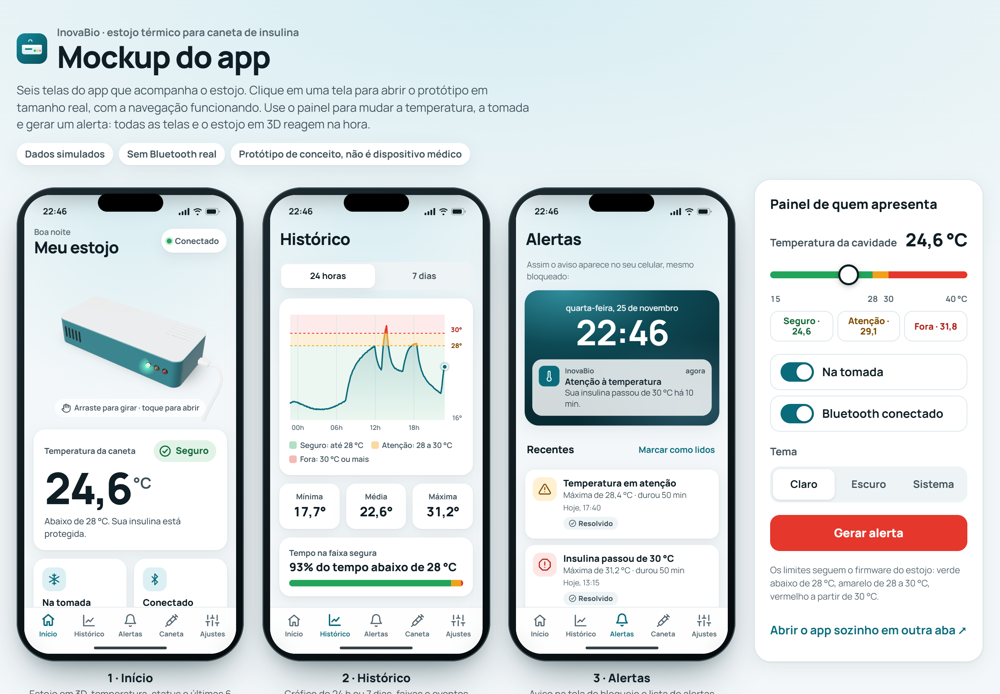

# InovaBio · mockup do app do estojo térmico

Mockup navegável do app que acompanha o estojo térmico InovaBio para uma caneta de insulina.
É só design: **dados simulados, sem Bluetooth de verdade**. Protótipo de conceito, não é dispositivo médico.



## O que tem aqui

| Arquivo | Para que serve |
|---|---|
| `index.html` | Página de apresentação: as 6 telas lado a lado em molduras de celular e o painel de quem apresenta. Clicar numa tela abre o protótipo em tamanho real. |
| `app.html` | O app em si (390 × 844). Aberto sozinho, mostra um botão **Simular** com o mesmo painel. |
| `js/estojo3d.js` | Estojo em 3D (three.js 0.170.0 via CDN, import map). Modelado com as medidas reais: caixa 186 × 80 × 40 mm, cavidade 172 × 24 × 24 mm, 3 LEDs de Ø5,4 mm, fendas e entrada USB-C. |
| `js/sim.js` | Limites de temperatura, histórico simulado (7 dias) e o estado compartilhado entre as telas. |
| `js/app.js` | Lógica das telas. |
| `screens/` | PNG de cada tela (390 px, 2×). |

Os limites são os mesmos do firmware (`prototipo/firmware/estojo_v1/estojo_v1.ino`):
**verde abaixo de 28 °C, amarelo de 28 a 30 °C, vermelho a partir de 30 °C** (e também em 2 °C ou menos).

## Abrir no computador

Precisa de um servidor local (os módulos JavaScript não abrem direto do arquivo):

```powershell
cd app_mockup
python -m http.server 8000
```

Depois abra <http://localhost:8000>. Para o app sozinho: <http://localhost:8000/app.html>.

## Publicar no GitHub Pages

O mockup é um site estático: todos os caminhos são relativos, não há etapa de build e o arquivo `.nojekyll` já está na pasta.

**Jeito mais simples (repositório só com o mockup):**

1. Crie um repositório novo no GitHub (por exemplo `inovabio-app-mockup`).
2. Envie o **conteúdo** desta pasta para a raiz do repositório, na branch `main`:
   ```powershell
   cd app_mockup
   git init -b main
   git add .
   git commit -m "Mockup do app InovaBio"
   git remote add origin https://github.com/SEU-USUARIO/inovabio-app-mockup.git
   git push -u origin main
   ```
3. No GitHub: **Settings → Pages → Build and deployment → Source: GitHub Actions**.
   O workflow `.github/workflows/pages.yml` publica sozinho a cada push.
   (Também funciona com **Deploy from a branch → main → / (root)**, sem o workflow.)
4. O endereço fica `https://SEU-USUARIO.github.io/inovabio-app-mockup/`.

**Se o repositório for o projeto inteiro** (com o mockup dentro de `app_mockup/`): copie a pasta `.github` para a raiz do repositório. O workflow detecta a pasta `app_mockup/` e publica só ela.

## Usar um modelo 3D próprio

Coloque `assets/estojo.glb` (ou `.gltf` ou `.stl`) e ele substitui o estojo modelado em código, já em escala.
Com um arquivo externo, os LEDs, a tampa animada e o brilho de resfriamento do modelo em código deixam de aparecer.
Sem o arquivo, o console mostra três avisos 404 da busca: é esperado.

## Parâmetros de URL (para capturas e testes)

`app.html?tela=historico&temp=29.1&tomada=0&conectado=1&tema=escuro&tampa=aberta&passo=encontrado&limpo=1&moldura=1`

- `tela`: `inicio`, `historico`, `alertas`, `caneta`, `ajustes`, `pareamento`
- `limpo`: esconde o botão Simular · `moldura`: mostra a barra de status do celular
- `captura`: preserva o quadro do 3D (necessário para print em navegador sem tela)
